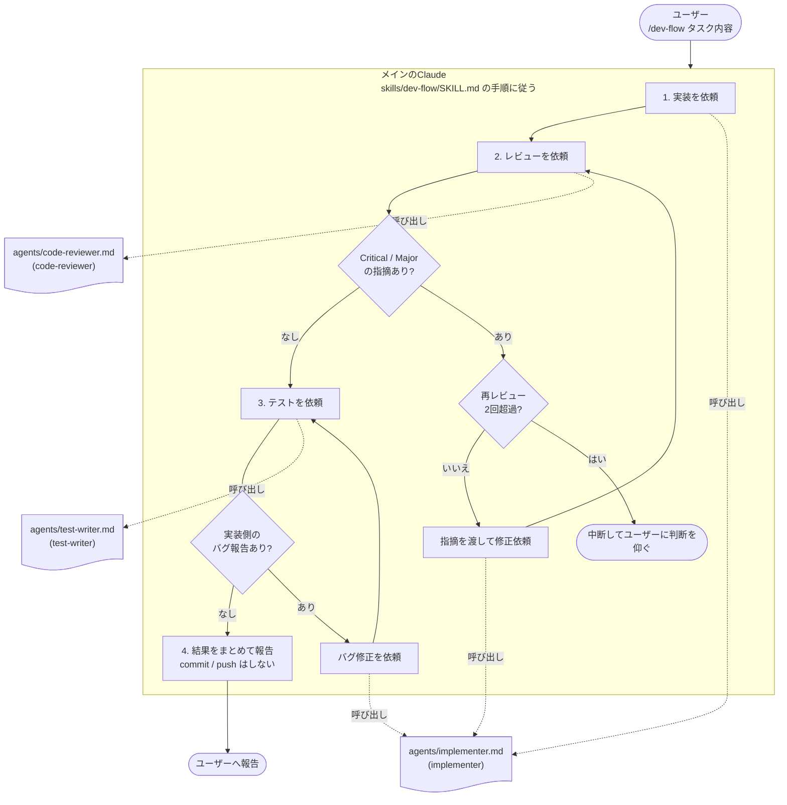
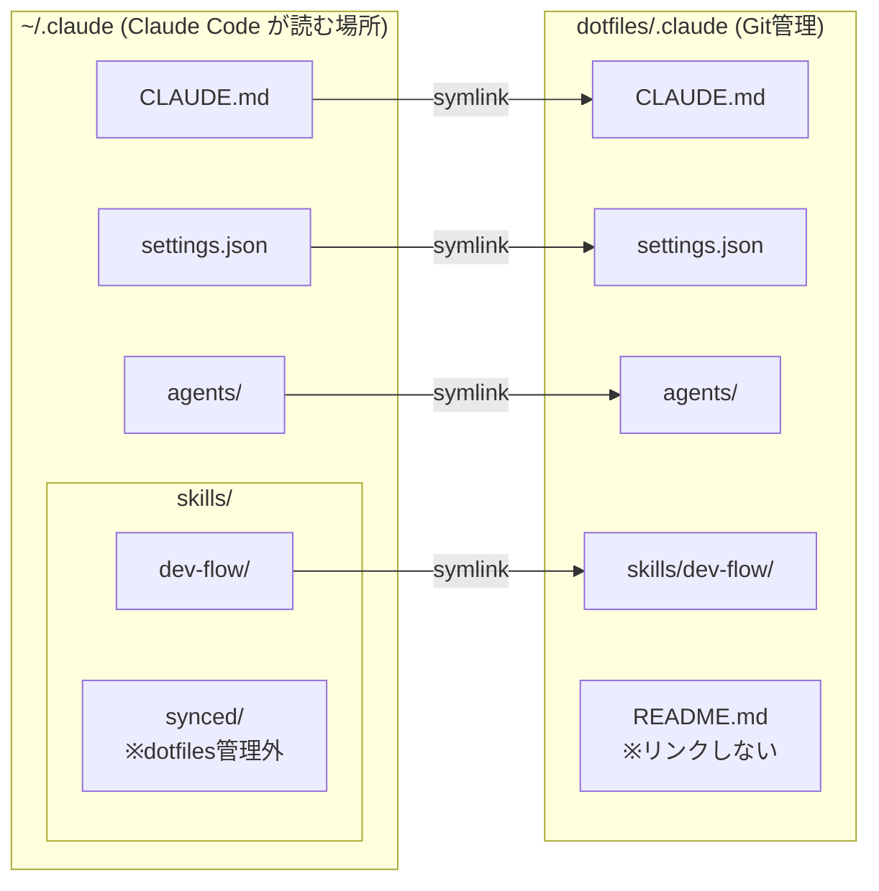

# .claude ディレクトリ構成

Claude Code のグローバル設定・サブエージェント・スキルを管理するディレクトリ。
人間が構成を把握するための資料であり、Claude Code はこのファイルを自動では読み込まない。

> [!NOTE]
> `agents/` 配下の `.md` はすべてサブエージェント定義として読み込まれるため、説明用のファイルは `agents/` に置かず、この README に集約する。

## ファイル一覧

```
.claude/
├── README.md                 # 本ファイル(人間向け・Claudeは自動で読まない)
├── CLAUDE.md                 # グローバル指示(全セッションで読み込まれる)
├── settings.json             # グローバル設定(権限・言語・テーマ等)
├── agents/                   # サブエージェント定義
│   ├── implementer.md        #   実装担当
│   ├── code-reviewer.md      #   コードレビュー担当(読み取り専用)
│   └── test-writer.md        #   テスト実装担当
└── skills/
    └── dev-flow/
        └── SKILL.md          # /dev-flow : 上記3エージェントを順に呼ぶ手順書
```

## 処理フロー(/dev-flow)

`/dev-flow <タスク内容>` を実行すると、メインの Claude が `SKILL.md` の手順に従って各サブエージェントを順に呼び出す。
サブエージェントは他のサブエージェントを呼べないため、呼び出しと結果の受け渡しはすべてメインの Claude が行う。



### 凡例

**線の種類**

| 線 | 意味 |
|---|---|
| 実線の矢印(`──▶`) | メインの Claude 内での処理の流れ(次に進むステップ)。矢印上の文字(なし / あり / はい / いいえ)は分岐の条件 |
| 点線の矢印(`- - ▶` 「呼び出し」) | メインの Claude がサブエージェントに作業を依頼すること。サブエージェントは作業結果をメインの Claude に返し、処理は実線の流れに戻る |

**図形の種類**

| 図形 | 意味 |
|---|---|
| 角丸(楕円)の図形 | 開始・終了(ユーザーからの起動、ユーザーへの報告、中断) |
| 四角形(枠内) | メインの Claude が行う処理ステップ |
| ひし形 | 条件による分岐 |
| ドキュメント形(下辺が波線の図形) | サブエージェントの定義ファイル(`agents/*.md`)。1図形 = 1ファイル |
| 大きな枠 | メインの Claude が `SKILL.md` の手順に従って担当する範囲 |

> [!NOTE]
> ドキュメント形は Mermaid v11.3.0 以降の記法(`@{ shape: doc }`)で記述している。古い Mermaid で表示するとエラーになる場合がある。

## サブエージェントの責務

| エージェント | 定義ファイル | 使えるツール | 責務 | やらないこと |
|---|---|---|---|---|
| implementer | `agents/implementer.md` | Read, Edit, Write, Grep, Glob, Bash | プロダクションコードの実装、レビュー指摘・バグの修正 | テストコードの作成、commit / push |
| code-reviewer | `agents/code-reviewer.md` | Read, Grep, Glob, Bash | `git diff` を読み、重大度付きで指摘を出す。「承認可 / 要修正」を判定する | コードの変更(Edit / Write を持たない) |
| test-writer | `agents/test-writer.md` | Read, Edit, Write, Grep, Glob, Bash | 同値分割・境界値分析でテストを設計・実装・実行する | プロダクションコードの修正、期待値の改ざん |

## シンボリックリンクの対応

dotfiles 側のファイルを正とし、`~/.claude` 側からシンボリックリンクで参照する。
`~/.claude/skills` には他のスキル(`synced` など)も置かれるため、ディレクトリごとではなくスキル単位でリンクする。



| `~/.claude` 側 | リンク先(dotfiles) | 単位 |
|---|---|---|
| `~/.claude/CLAUDE.md` | `.claude/CLAUDE.md` | ファイル |
| `~/.claude/settings.json` | `.claude/settings.json` | ファイル |
| `~/.claude/agents` | `.claude/agents` | ディレクトリ |
| `~/.claude/skills/dev-flow` | `.claude/skills/dev-flow` | ディレクトリ(スキル単位) |

リンクの作成手順はリポジトリ直下の [README.md](../README.md) の「Claude Code設定」を参照。

## エージェント・スキルを追加するとき

- **サブエージェントを追加する場合**：`agents/<name>.md` を作成する。`agents/` ごとリンクしているため、追加のリンク作業は不要。
- **スキルを追加する場合**：`skills/<name>/SKILL.md` を作成し、`~/.claude/skills/<name>` へのシンボリックリンクを追加する。
- 追加・変更したら、この README の図と表も更新する。
